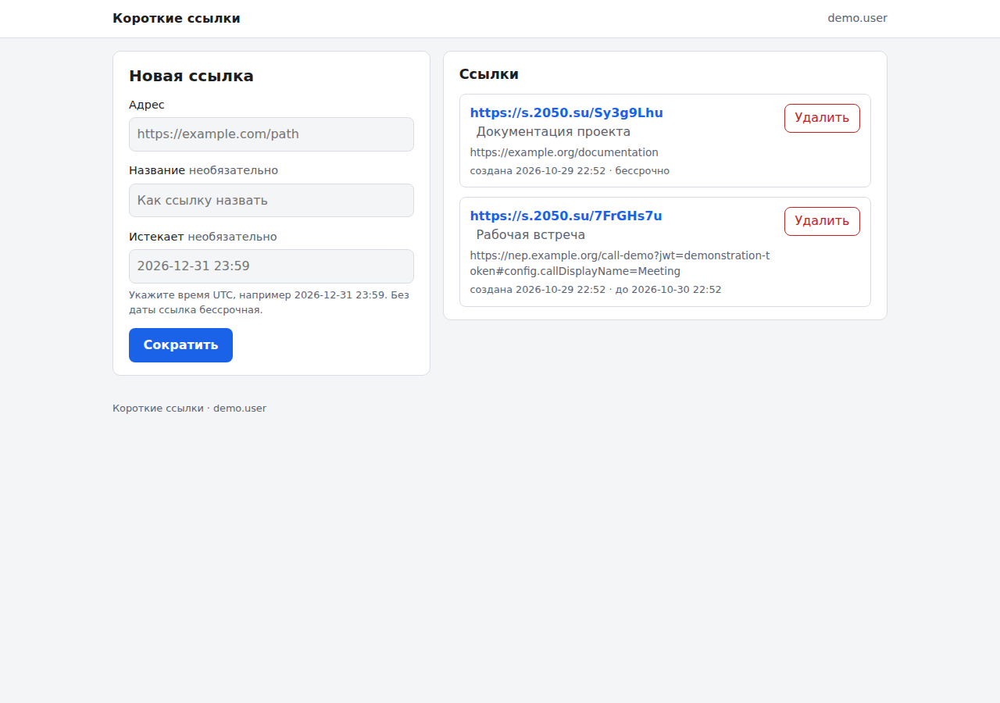
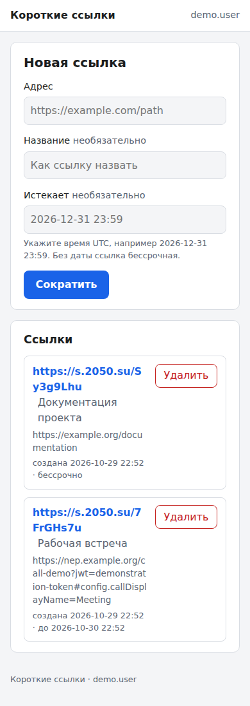

# shortlinks

A self-hosted short-link service for the public origin
[`https://s.2050.su`](https://s.2050.su). The management interface and API are
protected at the reverse proxy by OIDC and the `/links` group; public short
links are redirect-only.

> **Current status:** source code and local deployment materials are present.
> No production deployment or public integration is claimed here.

## What it does

- creates opaque, eight-character short codes for HTTP(S) destinations;
- keeps links private to their authenticated owner;
- encrypts destinations at rest in SQLite;
- supports optional UTC expiry, owner-only revocation, and API idempotency;
- checks destinations weekly and removes only after two separated missing
  checks; check state is persisted with the link;
- renders a small responsive Russian management interface without external
  assets.

## Management UI

The screenshots below document the interface from the local application.
They are intentionally free of credentials and real tokens.





## Quick local checks

Requires Go 1.26.10:

```sh
go test -race ./...
go vet ./...
```

Additional security checks used by CI are:

```sh
govulncheck ./...
gosec ./...
gitleaks git --redact --no-banner
```

Build a local container after the service entrypoint is available:

```sh
docker build --tag shortlinks:local .
```

For deployment requirements, reverse-proxy behavior, secret handling, and
backups, read [docs/deployment.md](docs/deployment.md). For disclosure and
security boundaries, read [SECURITY.md](SECURITY.md).

## API

The authenticated API is under `/api/v1/links`. It is intentionally accessible
only through the reverse proxy. API clients use their own proxy-issued bearer
token with the `/links` group and send `X-Shortlinks-Client: api`; they never
receive the proxy assertion key.

The OpenAPI description is maintained at `docs/openapi.yaml`.

## License

[MIT](LICENSE)
